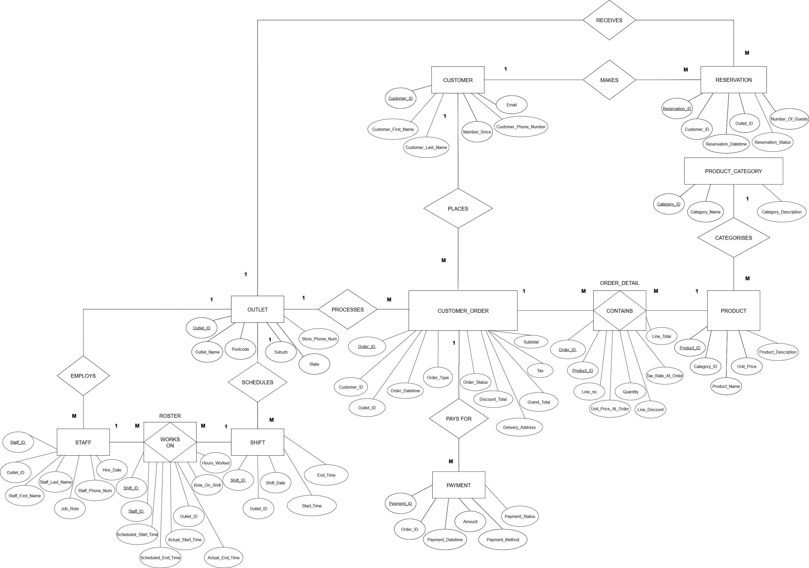

# Urban Eats Café Chain Database

## 📌 Project Overview

A relational database project supporting the operations and reporting needs of a café chain. The project translates business requirements into an Entity–Relationship Diagram (ERD), implements a MySQL database and uses SQL queries to investigate five operational questions.

Developed for **BUSA8090 – Data and Visualisation for Business**, Macquarie University.

### Business Relevance

- **Operations managers:** Identify busy periods and review staffing coverage.
- **Outlet managers:** Monitor reservations, sales channels and product performance.
- **Management:** Use consistent records to support operational planning and reporting.

## 🛠️ Tools & Skills

MySQL · SQL · Entity–Relationship Modelling · Relational Database Design · Data Integrity · Business Reporting

## 📂 Database Design

The schema contains **11 tables** covering café locations, customers, staff, transactions and scheduling.

| Area | Tables |
| --- | --- |
| Outlets and staffing | `OUTLET`, `STAFF`, `SHIFT`, `ROSTER` |
| Customers and bookings | `CUSTOMER`, `RESERVATION` |
| Products | `PRODUCT_CATEGORY`, `PRODUCT` |
| Orders and payments | `CUSTOMER_ORDER`, `ORDER_DETAIL`, `PAYMENT` |

Two associative tables resolve many-to-many relationships:

- **ROSTER:** Links staff to shifts and records scheduled and actual working times.
- **ORDER_DETAIL:** Links orders to products and stores quantities, discounts and prices at the time of ordering.

## 🔎 Project Workflow

### 1. Business Requirements & ERD

- Identified entities, attributes, primary keys and foreign keys.
- Defined relationship cardinalities and business rules.
- Created a Chen-notation ERD to represent the café chain's operations.

### 2. MySQL Implementation

- Implemented tables with primary and foreign keys, checks and enumerated values.
- Inserted dummy data to demonstrate relationships and query behaviour.
- Stored line-item price and tax snapshots to preserve transaction details independently of current product prices.

### 3. SQL Business Analysis

| Business question | Analysis | Decision supported |
| --- | --- | --- |
| When is demand highest? | Orders and revenue by outlet, weekday and hour | Staffing and preparation planning |
| How reliable are reservations? | No-show and cancellation rates by outlet | Booking confirmations and reminder policies |
| How do sales channels perform? | Approved payments, refunds and net collections by order type | Channel review and pricing discussions |
| Which menu items perform best? | Product sales and revenue | Menu promotion and product review |
| How does staffing compare with the roster? | Scheduled versus actual hours and potential shift exceptions | Labour monitoring and roster review |

## 📊 Outcomes

- Built a relational foundation connecting orders, payments, bookings and staffing records.
- Produced SQL query outputs demonstrating how operational data can support management decisions.
- Recommended improvements to staffing guides, reservation reminders and menu reporting.
- Identified additional data requirements, including table capacity, product costs and delivery fees.

The database uses **dummy data**. Query outputs demonstrate analytical methods rather than measured improvements in a real café business. Demand analysis summarises historical activity; it does not implement a forecasting model.

## 💡 Key Takeaways

- **Business requirements guide the schema:** Clear relationships make operational reporting possible.
- **Historical details matter:** Order-line snapshots retain the prices and tax rates associated with each transaction.
- **Revenue is not profit:** Net collections exclude product costs and channel fees, so they cannot establish profitability.
- **Data coverage shapes insight:** Reservation records alone cannot measure table utilisation without table and seating-capacity information.

## 📝 Project Materials

The project report documents the ERD, table implementation, dummy-data insertion, SQL queries and result screenshots. This README is based on that report; standalone SQL scripts have not been supplied or executed here.
